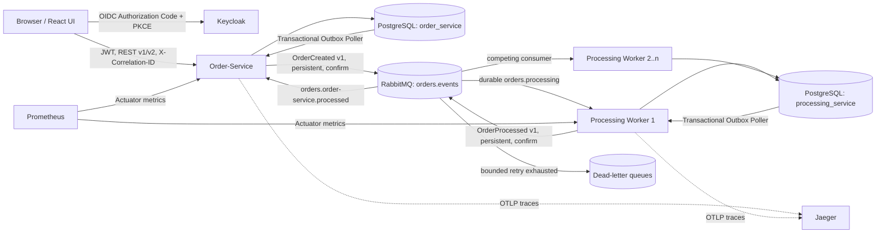

# Architektur

## Komponenten und Grenzen

## End-to-End-Datenfluss

1. Die UI authentifiziert den Benutzer bei Keycloak über Authorization Code + PKCE.
2. Sie sendet v1 oder v2 mit JWT und Correlation-ID an den Order-Service.
3. Eine Datenbanktransaktion speichert Orderstatus `ACCEPTED` und `OrderCreated` in der Order-Outbox.
4. Der Outbox-Poller publiziert persistent und wartet auf RabbitMQ Publisher Confirm. Erst dann markiert er das Event als publiziert.
5. Ein Processing-Worker beansprucht die Nachricht. Inbox-Deduplication, Verarbeitung und Processing-Outbox laufen in einer Transaktion.
6. Bei einem Fehler rollt auch der Inbox-Eintrag zurück. RabbitMQ führt höchstens drei Zustellversuche aus und verschiebt danach in die DLQ.
7. Der Processing-Outbox-Poller publiziert `OrderProcessed`; der Order-Service dedupliziert persistent und setzt den Status auf `PROCESSED`.

Damit gilt mindestens einmalige Zustellung mit idempotenter Verarbeitung. Ein Ausfall zwischen fachlichem Commit und Publikation verliert kein Event; der Poller nimmt unveröffentlichte Einträge nach Ablauf der Lease erneut auf.

## Datenautonomie

PostgreSQL ist lokal eine Instanz, aber über zwei Eigentümer und Schemas isoliert:

- `order_service`: Orders, empfangene Processed-IDs und Order-Outbox
- `processing_service`: persistente Inbox/Idempotenz und Processing-Outbox

Jeder Service erhält nur den eigenen Datenbankbenutzer. Kein Service greift auf fachliche Tabellen des anderen zu. Das Demo-Skript verwendet den DB-Admin nur für den kontrollierten Duplicate-Nachweis.

## Messaging und Resilienz

- Topic Exchange: `orders.events`
- Routing Keys: `order.created.v1`, `order.processed.v1`
- Durable Queues: `orders.processing`, `orders.order-service.processed`
- DLX: `orders.dlx`
- DLQs: `orders.processing.dlq`, `orders.order-service.processed.dlq`
- persistente Messages, Publisher Confirms und Mandatory Returns
- begrenzter Listener-Retry, danach DLQ; Prefetch 1 für Backpressure
- Graceful Shutdown sowie persistente RabbitMQ-/PostgreSQL-Volumes

## Observability

Beide Services schreiben strukturierte JSON-Logs mit `traceId`, `spanId`, `correlationId`, Event- und Order-ID. Spring-AMQP-Observations übertragen Trace-Kontext über den Broker. OTLP-Traces gehen an Jaeger; Actuator liefert Liveness, Readiness und Prometheus-Metriken. Die fachliche Correlation-ID bleibt zusätzlich über alle Servicegrenzen stabil.

## Deployment

Docker Compose startet UI, Keycloak, RabbitMQ, PostgreSQL, Order-Service, einen Processing-Worker, Jaeger und Prometheus in einem isolierten Netzwerk. Nur UI, Order-API und Administrationsoberflächen sind zum Host veröffentlicht. Processing bleibt intern und kann unabhängig auf 0 bis 20 Instanzen skaliert werden.
